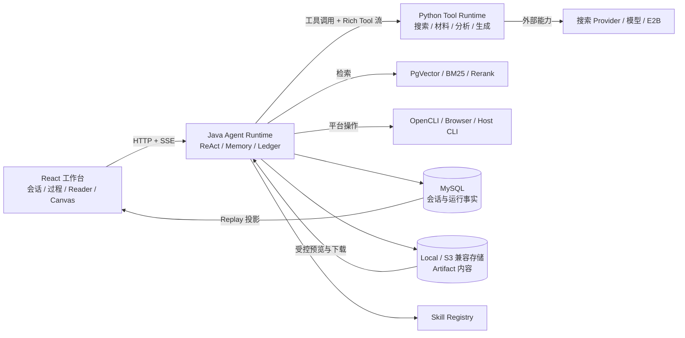

<p align="center"></p>

<h1 align="center">WhatUWish</h1>

<p align="center"><strong>全网情报研究与数据分析 Agent</strong></p>

<p align="center">
  从分散的网页、社区讨论和个人文件中找到线索，<br>
  把线索变成有来源的判断、有计算过程的分析，以及真正能打开、编辑和交付的作品。
</p>

<p align="center">
  
  
  
  
  
</p>

<p align="center">
  <a href="#为什么是-whatuwish">产品定位</a> ·
  <a href="#真实任务可以怎么做">场景展示</a> ·
  <a href="#核心能力">核心能力</a> ·
  <a href="#一次任务如何完成">工作流程</a> ·
  <a href="#系统架构">系统架构</a> ·
  <a href="#快速开始">快速开始</a>
</p>

<!-- 产品首屏：assets/readme/workbench-overview.png。使用真实工作台截图，展示会话、执行过程与交付区。 -->

## 为什么是 WhatUWish

想判断一个方向值不值得做，信息可能散落在新闻、论坛、社交平台、开源社区和手边的表格里。搜索只能给出候选链接；一次聊天总结也难回答“依据来自哪里、数据怎么算的、下一步能不能继续做”。

**WhatUWish 让 Agent 沿着问题自主寻找信息、验证证据、处理材料，并把研究直接推进到可使用的成果。** 它既能搜索公开网页、追踪社区原生内容，也能阅读会话中上传的 PDF、文档和表格；需要计算时进入代码与数据工作区，需要表达时生成报告、图表、演示文稿、图片或交互画布。

这里的“完成任务”不只是一段回答。来源会成为可以回看的研究材料，分析会留下文件与执行过程，生成物可以在工作台直接阅读或下载；下次打开同一会话，Agent 还能继续使用历史、文件和沉淀下来的 Skill。

> **一句话：从全网线索到可信判断，再到可以拿走的成果。**

## 真实任务可以怎么做

下面的任务示例对应项目已有的工具链，各场景已预留真实运行截图位置。

### 1. 全网技术与产品情报

一个技术方向的热度不能只看搜索排名。WhatUWish 可以把公开网页的报道，与 Hacker News、X、Reddit、GitHub Trending、Stack Overflow 等社区入口中的一手讨论放在一起研究：先找候选，继续读取正文与评论，区分发布方观点、使用者反馈和可核对事实，再整理为带来源的研究材料。

复杂问题交给 DeepSearch 拆成互补查询，并发搜索、筛选来源、抓取正文、核对证据和有限补查；简单问题则直接搜索和抓取。研究材料可继续进入报告或数据分析，不需要从聊天记录中手工复制。

> **试试这样问：**“研究最近一个月开源 AI 浏览器项目的变化。对照官网、GitHub 趋势和社区讨论，整理主要方案、真实反馈、争议点及来源，最后给我一份可继续加工的研究材料。”

<!-- 真实截图：assets/readme/research-sources.png（多来源检索与引用）；assets/readme/deepsearch-timeline.png（DeepSearch 阶段）。 -->

### 2. 社区舆情与竞品对照

面对新品发布、行业事件或竞品更新，可以同时观察媒体报道、社区帖文、评论和平台热榜。Agent 根据问题选择对应平台的浏览器或 CLI 能力，读取原生页面内容，把来源链接、内容摘要和观察结果带回同一任务；再用 DeepSearch 扩大检索覆盖，形成“发生了什么、不同群体怎么说、哪些结论仍需验证”的分析。

这条能力适合追踪技术社区、新消费产品和内容平台的讨论，不把多个平台的搜索结果简单拼成一段没有出处的摘要。

> **试试这样问：**“对比两款产品最近一次版本发布后的用户反馈，分开整理官方更新、媒体报道和社区讨论，指出共识、分歧与值得跟进的问题。”

<!-- 真实截图：assets/readme/community-research.png（平台内容、来源列表与分析结论）。 -->

### 3. 把自己的文件带入研究

上传产品说明、研究 PDF、访谈记录、CSV 或 Excel 后，本轮任务可以直接引用这些会话文件。材料工具负责阅读、抽取、清理、转换、合并、聚合和校验；表格还可以通过只读 SQL 查询。网页正文与 DeepSearch 来源包也能进入同一 Run 工作区，与用户文件一起被分析。

当简单读取不够时，Agent 可以运行 Python 代码或多步 Code Interpreter：尝试分析、观察输出、修正计算，再把结果导出为图表、表格和文档。这样“网上怎么说”和“我的数据说明什么”能在同一条链路里对照。

> **试试这样问：**“附件是我们的测试数据和竞品功能表。结合公开评价，分析最受关注的差异，用实际数据做对照，生成图表、结论摘要和可下载的分析文件。”

<!-- 真实截图：assets/readme/files-and-analysis.png（会话文件选择、代码分析、图表及文件交付）。 -->

### 4. 从研究结果直接创作

研究完成后，可以让 Agent 基于已有来源材料和会话文件继续制作 Markdown、HTML、PDF、Word、PPTX、Excel 和 PNG 图表。Report 工具能自动发现当前任务的研究材料，也能按 Artifact ID 精确指定输入，生成正式 Markdown、HTML 或可预览的 HTML Slides。

需要可操作的表达时，可以发布 HTML Canvas，或让 GenUI 根据受控组件协议生成和更新图表、表单、教学内容及 3D 视图。视觉内容可由 Agent 生成图片，也可在独立图片工作台进行文生图、参考图编辑和遮罩编辑。

> **试试这样问：**“把前面的研究做成一份面向团队的方案报告、一页交互式指标对比画布和一张用于分享的封面图。报告保留来源，所有文件都放进交付区。”

<!-- 真实截图：assets/readme/report-and-slides.png、assets/readme/genui-canvas.png、assets/readme/image-workbench.png。 -->

### 5. 人机协作完成复杂网页任务

浏览器遇到登录、验证码或需要人判断的页面时，Agent 可以请求桌面接管。工作台展示等待中的远端桌面；用户完成操作后提交继续，Agent 在同一工作环境里接着查看页面和处理文件。源 Run、接管过程与续跑 Run 有关联，任务不会因为人工参与而断成互不相干的几段。

> **试试这样问：**“查看这个需要登录的页面，遇到登录步骤让我接管；完成后继续提取页面信息，并与我上传的表格核对。”

<!-- 真实截图：assets/readme/desktop-handoff.png（请求接管、人工操作、续跑结果）。 -->

### 6. 用内部知识校验公开信息

公开网页适合追踪新变化，内部知识库适合回答“我们过去怎么做、现有资料怎么说”。WhatUWish 可以先用 DeepSearch 了解外部方案，再对已入库的内部文档做增强 RAG 检索；向量和关键词两路召回经过融合与精排后，只把相关证据交给 Agent。用户可按知识标签缩小范围，让外部趋势与内部约束在一份分析中相遇。

> **试试这样问：**“先研究最近的方案变化，再查我们的内部技术资料。指出哪些做法可以直接借鉴、哪些与现有架构冲突，并分别列出外部和内部依据。”

<!-- 真实截图：assets/readme/public-and-private-evidence.png（DeepSearch 来源与 RAG 证据对照）。 -->

### 7. 从已有成果继续做下一版

一次任务生成的研究材料、文档和图表不需要在下一轮重新输入。用户可以回到会话，复用文件，要求 Agent 根据新的问题补查来源、修改分析或制作另一种交付物。会话搜索找回较早讨论，Skill 发现找回已经沉淀的方法；Live 过程和历史回放让“为什么改成这一版”也有迹可循。

> **试试这样问：**“沿用上次的研究材料，把结论改成面向非技术同事的版本。补上这周的新信息，保留已有图表，并导出可以分享的页面。”

<!-- 真实截图：assets/readme/continue-a-session.png（会话历史、旧文件复用与新交付）。 -->

## 信息从哪里来

WhatUWish 把信息源看成任务可选择的能力，而不是让用户提前整理成一份大文本。Agent 可以根据目标决定先广泛发现、再阅读原文，或直接进入已经入库的资料和用户文件。

| 信息类型 | 可用入口 | 在任务中的作用 |
| --- | --- | --- |
| 公开互联网 | Web 搜索、网页正文抓取、DeepSearch | 发现候选、核对原文、形成带来源的研究材料 |
| 技术与开源社区 | Hacker News、GitHub Trending、Stack Overflow、V2EX 等平台读取 | 观察开发者讨论、趋势项目和具体问题 |
| 社交与内容平台 | X、Reddit、YouTube、B 站、小红书、微博等平台入口 | 读取帖子、视频信息、评论或热榜中的原生内容 |
| 其他垂直信息 | 雪球等平台入口 | 获取特定领域的公开动态与页面资料 |
| 内部资料 | 已入库知识的 RAG 检索 | 对照内部文档、规范和历史沉淀 |
| 用户自己的材料 | 会话上传与复用的文档、表格、图片 | 把真实业务数据带入研究和生成流程 |
| 既有成果 | 同会话 Artifact、历史消息、Skill 包 | 在已有结论、文件和方法上继续工作 |

公开搜索、平台读取和知识库检索的职责不同：搜索帮助发现，平台工具进入原生内容，RAG 从已入库资料寻找依据。Agent 可以组合它们，但最终交付仍保留各自来源，不把不同渠道的结果混成无法检查的一段话。

## 核心能力

### 01 / 多来源发现：搜索、平台内容与 DeepSearch

- **公开网页**：普通搜索提供标题、摘要、链接及 Provider 信息；网页抓取提取正文，并将原文作为来源文件保存。支持域名范围控制。
- **深度研究**：DeepSearch 从研究问题拆分开始，执行多查询并发检索、来源筛选、正文抓取、证据综合和按需补查；提供 quick、standard、deep 研究深度。
- **原生平台内容**：浏览器、云端浏览器和宿主 CLI 按运行环境装配，让 Agent 能使用平台自身的搜索、阅读和交互能力，而不只依赖通用搜索引擎摘要。
- **内部知识**：RAG 工具面向已经入库的资料，执行 Query Rewrite、PgVector 向量召回、BM25 关键词召回、RRF 融合与 BGE Rerank，并支持知识标签筛选。公开最新信息与内部知识各有入口，Agent 可在任务中结合两种证据。

### 02 / 真正处理材料：会话文件、数据工具与代码分析

- 会话文件可上传、选择和复用；PDF、DOCX、Excel、CSV、HTML、Markdown 与文本可以进入材料阅读链路。
- 数据处理覆盖清理、转换、合并、分组聚合、校验和只读 SQL；处理结果可以继续供后续工具使用。
- 受控代码执行保留标准输出、错误输出、退出状态和生成文件；Code Interpreter 能在多步循环里边执行边修正。
- 网页来源、用户文件和工具生成物具有不同身份；材料进入工作区后仍能追溯来自哪个会话、Run 和工具。

### 03 / 多形态交付：文档、图片与交互画布

- **报告与文档**：研究材料、已有文本 Artifact 或会话材料可作为输入，生成 Markdown、HTML、HTML Slides；文档工具还能制作 PDF、DOCX、PPTX、XLSX 与 PNG 图表。
- **图片创作**：Agent 内部与独立工作台都支持图片生成；可使用参考图编辑或遮罩限定修改区域，结果登记为可预览和下载的图片 Artifact。
- **HTML Canvas**：把工作区生成的 HTML 发布到会话画布，直接在工作台打开。
- **GenUI**：Agent 通过 UI Tree 和增量 Patch 组织可交互界面；工作台按组件合同呈现图表、表单和 3D 内容，并支持画布导出。
- **跨格式阅读**：Markdown、文本、HTML、图片、PDF、DOCX、CSV 和 XLSX 在工作台有对应 Reader；PPTX 等原文件可下载。

### 04 / 记忆会进化：跨 Run 续接与经验沉淀

WhatUWish 的记忆不是把全部历史塞回模型。ReAct 工作记忆按消息逐条持久化；新 Run 可以恢复同会话的有效上下文，长任务按预算压缩，工具批次按模型发起顺序收敛。即使一次任务被打断，后续运行仍有可恢复的会话脉络。

当当前上下文不够时，Agent 可用 `session_search` 搜索较早会话，再按命中位置滚动阅读具体片段。这让过去讨论过的约束、结论和用户材料能被按需找回，而无需每轮装载整个历史。

成功任务还可以触发独立的后台 Skill 复盘：识别有复用价值的方法，受控更新或创建 Skill 文件，刷新注册中心，供之后的任务发现和调用。复盘与主任务的消息、账本、事件和产物隔离，用户看到的是主任务本身的运行事实。

### 05 / Skill 与工具生态：需要什么，再加载什么

Agent 通过 `skills_search` 搜索名称、描述和标签，再用 `skill_view` 读取需要的技能正文及包内资料。初始提示只包含有预算的技能索引，避免把所有 Skill 内容一次性注入上下文。

Skill 包可以包含 `SKILL.md`、参考资料、资源和脚本。运行时提供包内读取、目录浏览、搜索及受控脚本入口；已有的 smart-search、OpenCLI 使用与浏览器技能，以及 GitHub 深度研究技能，展示了信息源策略与操作流程如何从一次任务变成可复用能力。

Java 原生工具、Python 工具、MCP、浏览器和 Skill 统一进入 ReAct 的工具选择与 observation 链路。新增能力可以成为正式运行时工具，而不需要把所有逻辑写进一段巨大的系统提示词。

### 06 / ReAct 执行：会观察、会调整的多步任务

Agent 按“决策 → 调用工具 → 观察结果 → 继续或收敛”推进任务。工具 observation 保留对下一步有用的来源、计算结果、文件身份和错误信息；模型可以据此继续搜索、改用材料工具、补做计算或直接交付。

同一轮互不依赖的工具调用可以并发执行，完成后仍按模型发起顺序写回 observation。普通工具和 Rich Tool 共用工具运行与执行账本，长时间运行的 DeepSearch、报告、代码分析和图片创作还会持续给出阶段进度。

### 07 / 过程可看、结果可回：Ledger 与 Artifact

运行账本分别记录 Run、Step、模型调用、工具调用、阶段事件和 Artifact。Rich Tool 的过程先持久化，再推送 Live SSE；历史回放从同一批已保存事实重建。因此用户可以在工作台看到任务正在做什么，稍后也能回到同一会话检查来源、工具结果和交付文件。

Artifact 是有身份的真实文件，不是一句“文件已生成”。文件服务按 Run 和 Artifact 提供元信息、预览与流式下载；Local 和 S3 兼容存储通过同一访问入口接入，工作台不暴露存储内部路径。

### 08 / 工作台：对话之外的研究工作区

React 工作台把任务输入、附件、会话历史、实时过程、来源、画布和文件交付放进同一操作路径。用户可以从当前 Run 跳到历史回放，打开 Reader 检查文档和数据，继续追问或复用已有材料；独立图片工作台承接不依赖 Agent 会话的创作任务。

<!-- 功能截图：assets/readme/runtime-and-replay.png、assets/readme/artifact-reader.png、assets/readme/skills-and-memory.png。 -->

### 工作台里会看到什么

| 区域 | 使用体验 |
| --- | --- |
| 任务输入 | 写下目标、选择 Agent、设置步骤预算，并为本轮选择要使用的会话文件 |
| 会话与历史 | 找回以前的任务，继续同一话题，或查看某次 Run 的完整回放 |
| 运行过程 | 观察搜索、研究、代码分析、报告与生图的阶段进度和工具结果 |
| 来源与材料 | 查看研究来源、上传文件与本轮工作区里可以继续使用的材料 |
| 文件交付 | 在文件卡中打开 Reader、检查内容、下载原文件 |
| 画布 | 查看发布的 HTML 或 Agent 生成的交互式 GenUI |
| 图片工作台 | 独立创建、编辑和回看图片，不必先发起一条 Agent 研究任务 |

Reader 不是浏览器里的一个通用附件链接：Markdown 和文本支持长文阅读，HTML 使用隔离预览，图片可以直接查看，PDF 与 DOCX 有文档阅读界面，CSV / XLSX 可切换工作表并搜索、浏览有界数据。用户拿到的是原始文件，也能先在工作台判断它是否符合预期。

## 一次任务如何完成

```text
提出问题 + 选择会话文件
        ↓
ReAct 判断任务 → 搜索网页 / 读取平台 / DeepSearch / RAG / Skill
        ↓
来源材料与用户文件进入受控 Run 工作区
        ↓
阅读、数据处理、代码分析，必要时人工接管浏览器
        ↓
报告 / 图表 / 文档 / 图片 / HTML Canvas / GenUI
        ↓
Artifact 登记 → 工作台预览与下载 → 同会话继续 / 历史回放
```

**来源有出处。** 搜索候选、抓取后的网页正文、研究来源包和用户上传文件分开记录；下一步工具能使用真正的材料，而不是只能引用模型对材料的印象。

**执行有反馈。** 工具结果面向下一次决策提供可用信息。长任务的阶段进度、普通工具的结果和中途错误都进入受控运行投影。

**交付有文件。** 工作区输出经过检查和登记后成为 Artifact；用户可以在 Reader 中阅读，或下载原文件继续编辑。

**会话能继续。** 工作记忆恢复当前任务脉络，`session_search` 找回更早的讨论，Skill 把可复用的方法带入未来任务。

### 为什么这条链路能持续工作

| 对象 | 记录的内容 | 带来的能力 |
| --- | --- | --- |
| Session | 连续讨论、会话文件与历史 Run | 在一项长期任务中复用材料和上下文 |
| Run / Step | 一次执行及其逐步推进 | 区分不同轮次，定位执行到哪一步 |
| Tool Invocation | 工具请求、观察结果与终态 | 让 Agent 下一步有真实依据，也让用户能复查 |
| Runtime Event | Rich Tool 有序的过程事实 | 同一事实支撑实时展示和历史回放 |
| Working Memory | 模型下次需要的对话与工具观察 | 跨 Run 续接，并控制上下文预算 |
| Artifact | 来源或交付文件的身份与状态 | 稳定预览、下载、引用和再次加工 |
| Skill | 可复用的任务方法与辅助资料 | 让经验在后续任务里按需被发现 |

这些对象彼此关联，但不互相冒充。比如，网页搜索结果只是候选线索；抓取后的正文才是可供继续阅读的来源材料；报告生成后还需要登记真实文件，才会进入交付区。这样的区分让一次复杂任务能够从“找到什么”一直走到“交出了什么”。

## 系统架构



Java 负责 Agent 决策、工具装配、会话与记忆、运行事实、文件身份和前端展示协议；Python 承载研究、材料处理、代码执行、文档与图片等执行内核。前端只消费 Java 的 API、SSE 和内容服务。模型看到的 observation、数据库保存的事实和用户看到的过程展示各有用途，文件正文不会因为要展示进度就被塞进事件流。

### 服务如何协作

1. **React 工作台**发起任务，上传或选择会话文件，并订阅当前 Run 的 SSE；用户还可以查询历史、预览文件和接管桌面。
2. **Java Runtime**准备会话工作区、加载工作记忆、装配可用工具，让 ReAct 在每一步选择下一项操作。
3. **Python Tool Runtime**执行搜索、深度研究、材料处理、代码分析、文档制作和图片任务；浏览器、宿主 CLI、MCP 与 Skill 则通过各自适配器加入工具集合。
4. **Ledger 与 Artifact 服务**记录模型和工具事实、接收 Rich Tool 的阶段事件，检查生成文件并提供有身份的交付入口。
5. **展示投影**把已经保存的运行事实转换为工作台可读的 Live 和 Replay 内容；Reader 按后端声明的文件预览类型读取内容。

ReAct 看到的是经过控制的 observation，而非全部数据库记录；工作台看到的是稳定的展示合同，而非工具私有 JSON。二者分别服务于“下一步该做什么”和“用户现在应看到什么”。

### 项目结构

```text
仓库根目录/
├── WhatUWish-api/             API 契约与 DTO
├── WhatUWish-app/             Spring Boot 启动、配置与集成测试
├── WhatUWish-case/            会话、执行和文件等应用用例
├── WhatUWish-domain/          ReAct、工具、记忆、Skill、Ledger、Artifact
├── WhatUWish-infrastructure/  MySQL、存储、外部服务与平台适配
├── WhatUWish-trigger/         HTTP、SSE、文件访问与浏览器控制入口
├── WhatUWish-types/           公共类型与配置
├── WhatUWish-tools-python/    FastAPI 工具服务与执行内核
├── frontend/                  React 工作台与跨格式 Reader
├── runtime/skills/            可发现的 Skill 包
└── docs/sql/                  功能数据库迁移脚本
```

Java 是 Maven 多模块工程；Python 工具服务和 React 工作台分别启动。所有运行过程与文件访问都由 Java 后端向工作台提供统一入口。

### 技术组成

| 层次 | 技术与职责 |
| --- | --- |
| Agent Runtime | Java 17、Spring Boot 3.4.3、Spring AI 1.1.0、ReAct |
| 工具服务 | Python、FastAPI、Rich Tool SSE、材料与文档处理 |
| 工作台 | React 19、TypeScript、Vite、ECharts、Three.js、跨格式 Reader |
| 数据与检索 | MySQL、Redis、PostgreSQL / pgvector、Elasticsearch / BM25、BGE Rerank |
| 文件与沙箱 | Local / S3 兼容对象存储、E2B、受控 Run 工作区 |
| 扩展入口 | Java Tool、Python Tool、MCP、Skill、OpenCLI、浏览器与宿主 CLI |

## 快速开始

### 环境要求

- JDK 17、Maven、Python 3、Node.js 与 npm。
- MySQL、Redis，以及开发配置中启用的检索或消息服务；要使用知识库检索，还需配置对应的 PgVector、Elasticsearch 和 Rerank 服务。
- Java 与 Python 所需的模型服务和 API Key。搜索、图片、E2B、浏览器等能力按各自配置接入。
- 数据库基础脚本位于 `docs/dev-ops/mysql/sql/xfg-frame-archetype.sql`，后续功能脚本位于 `docs/sql/`。已有数据库按当前版本执行对应迁移。

### 1. 配置服务

Java 本地配置示例：`WhatUWish-app/config/application.local.example.yml`。Python 本地配置示例：`WhatUWish-tools-python/config/application.local.example.yaml`。分别复制为同目录的 `application.local.yml` 和 `application.local.yaml`，填入自己的连接地址、模型与凭据。

材料与代码工具跨服务传输文件时，Java 的 `conversation.material.bridge-token` 和 Python 的 `material-bridge.token` 需要一致。启用代码执行或 Code Interpreter 时，按两端配置打开对应工具并配置 E2B。

### 2. 启动 Python Tool Runtime

```powershell
cd WhatUWish-tools-python
python -m venv .venv
.\.venv\Scripts\python.exe -m pip install -r requirements.txt
.\start-local.ps1
```

默认服务地址为 `http://127.0.0.1:18081`，可通过 `GET /api/v1/health` 检查。首次启动脚本会提示补齐本地配置。

### 3. 启动 Java Backend

在仓库根目录执行：

```bash
mvn -pl WhatUWish-app -am package -DskipTests
java -jar WhatUWish-app/target/WhatUWish-app.jar --spring.profiles.active=dev
```

开发配置默认监听 `http://127.0.0.1:8091`。根 POM 依赖 `xfg-wrench` BOM；构建环境需能解析相应 Maven 依赖。

### 4. 启动 React 工作台

```bash
cd frontend
npm install
npm run dev
```

打开 `http://127.0.0.1:5173`。默认 API 地址为 `http://127.0.0.1:8091`；后端端口变化时可设置 `VITE_AGENT_API_BASE_URL`。

### 开始一个任务

1. 在工作台新建会话，选择 ReAct Agent，写下研究问题与期望交付物。
2. 上传本地文件，或从会话文件中选择已有材料。
3. 在对话和工作区查看来源、工具过程、研究阶段与生成的文件。
4. 打开 Reader 阅读、下载原文件，或回到历史会话继续追问。

### 浏览器平台接入

仓库内的 `.local-opencli/adapter-host` 和 `.local-opencli/browser-extension` 是配套的 OpenCLI 命令端与浏览器扩展源码。Node.js 需为 20.18.1 或更新版本。在两个目录分别执行 `npm ci --ignore-scripts` 和 `npm run build`；命令端入口为 `.local-opencli/adapter-host/dist/src/main.js`。在 Chrome 或 Edge 的扩展管理页启用开发者模式，将 `.local-opencli/browser-extension` 作为已解压的扩展加载。

在 Java 本地配置中启用 `reactor.opencli.enabled` 与 `reactor.browser-relay.enabled`，将 `reactor.opencli.command` 设为 `node`，并在 `reactor.opencli.prefix-args` 中填入命令端入口的本机绝对路径。启动后端和工作台后，在工作台连接浏览器；扩展弹窗手动配对时，API 地址应指向 Java 后端。登录态平台使用所连接浏览器的当前会话。

桌面接管需配置 E2B。图片创作可以在 Agent 任务中使用，也可以进入独立图片工作台。

<!-- 后续补充：场景截图、演示视频与可公开的在线体验地址。 -->
